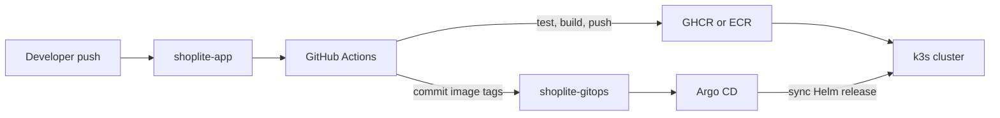
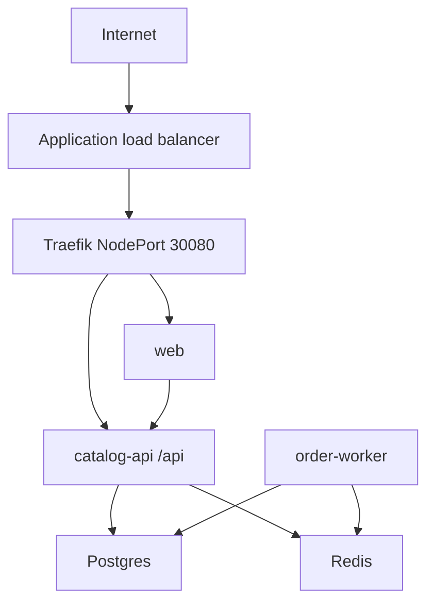

# ShopLite architecture

GitHub Actions builds and publishes images. Argo CD deploys whatever `shoplite-gitops` records. The pipeline does not run `kubectl apply`.

The nodes stay in private subnets. Session Manager is the admin path. Prometheus, Loki, and Tempo run in the `monitoring` namespace and read the metrics, JSON logs, and OpenTelemetry traces from the shop.
